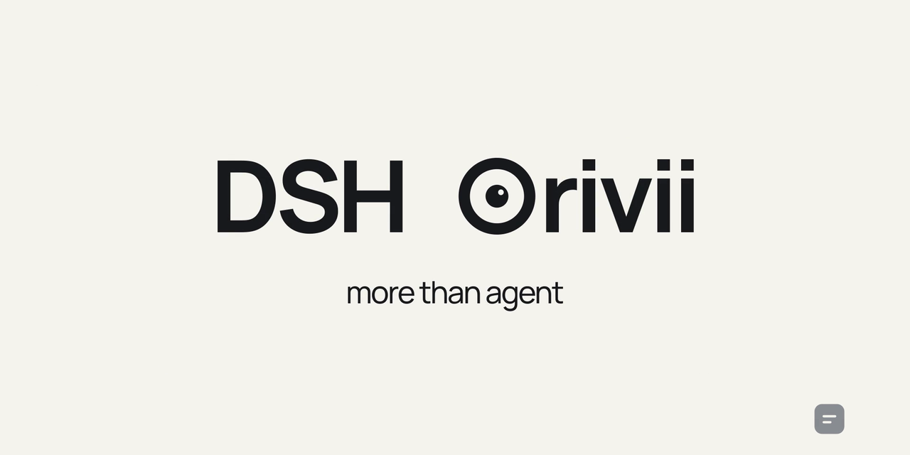
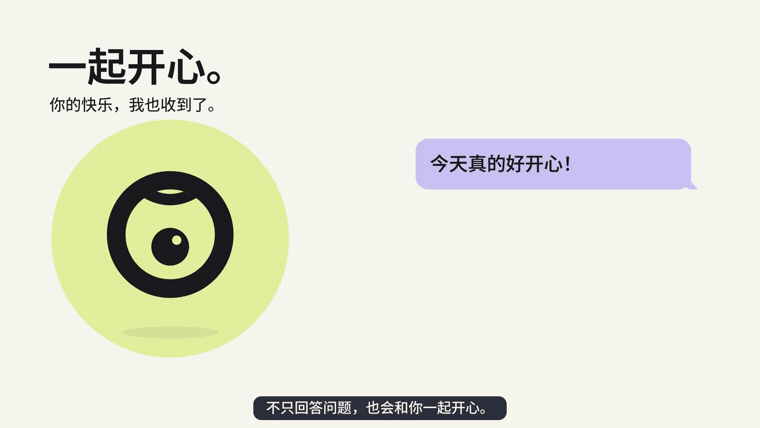
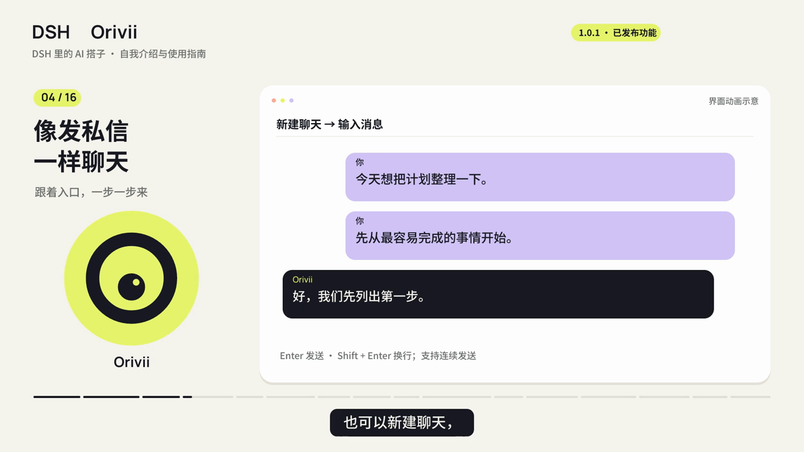
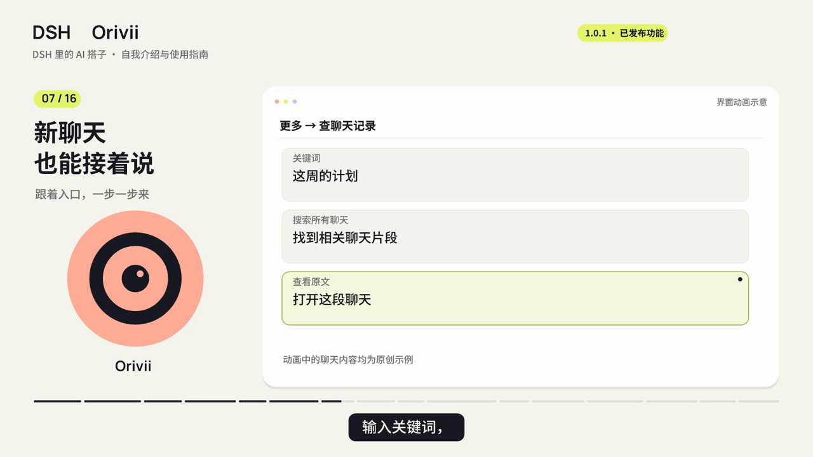
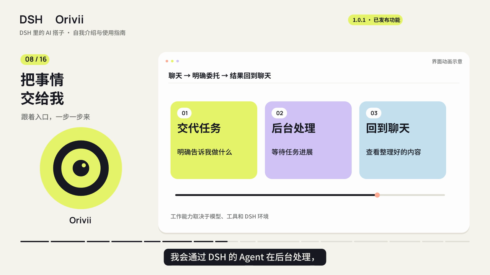
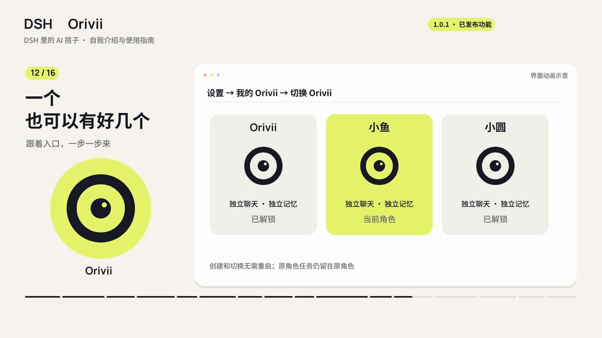

<p align="center">
  
</p>

<p align="center"><strong>Give your DSH an AI companion with a face.</strong><br><strong>Keep the conversation going. Let the work run in the background.</strong><br>Expressive eyes, shared chat history, reminders in your own words, and access to DSH tools.</p>

<p align="center"><a href="README.md">中文</a> · <a href="docs/README.md">User guide (Chinese)</a> · <a href="https://www.npmjs.com/package/dsh-orivii">npm</a> · <a href="https://github.com/ZekaiShi/Orivii/releases">Releases</a> · <a href="UPDATES.md">What's next</a></p>

## Get started

Version 1.0.2 is available through GitHub Release; npm availability can be checked in the registry.

With a working DSH installation and a configured model, install the prebuilt plugin:

```sh
dsh plugin --profile web add https://github.com/ZekaiShi/Orivii/releases/download/v1.0.2/dsh-orivii-1.0.2.tgz
```

On Windows PowerShell, use `dsh.cmd` in place of `dsh`. Desktop users can add **`https://github.com/ZekaiShi/Orivii/releases/download/v1.0.2/dsh-orivii-1.0.2.tgz`** through the app's plugin manager. Follow the host's restart instructions, open **Orivii** in the sidebar, choose a workspace, and set a name and password.

Requires Node.js **≥24.2.0** and a compatible **DSH 0.2.1** host. The npm package is **`dsh-orivii`**; the npm package named `dsh-companion` is a different project. [Full installation guide](docs/getting-started.md)

## Meet Orivii

[](https://github.com/ZekaiShi/Orivii/blob/main/media/orivii-film.mp4)

[Watch the full 60-second film](https://github.com/ZekaiShi/Orivii/blob/main/media/orivii-film.mp4). The animated preview and tutorial frames below use original demonstration scenes.

| A place to talk | Pick up a conversation |
| --- | --- |
|  |  |
| **Background work** | **Multiple companions** |
|  |  |

- **A place to talk.** Independent chats, rich text bubbles, consecutive messages, and expressive eye animations.
- **A conversation that carries on.** Recent dialogue and searchable history are shared across chats within one identity. Recall can be incomplete; important details should be checked against the original conversation.
- **Help with real tasks.** Search through DSH's web service, arrange reminders in natural language, and delegate explicit work to DSH agents. Available tools and host permissions determine what can actually run.
- **More than one Orivii.** Version 1.0.1 adds independent identities with separate chats, memories, and preferences. Switch without restarting DSH.
- **Less repeated unlocking.** Choose the current DSH run, 8 hours, or 24 hours. Refreshing or switching does not extend the deadline. A manual lock or host restart requires unlocking again.

Reminders require the DSH host to remain running and the relevant identity to remain unlocked. They arrive in the chat, not as an alarm that works after shutdown.

## New in 1.0.2

Send images and files from the composer, clipboard, or drag and drop. Each image gets its own bubble with a compact circular download button. Orivii can deliver real image and text-file attachments, reuse installed Bilibili tools, and customize bubble and character colors. Tool discovery and thinking-mode tool replay are more reliable.

[Images, Bilibili, and appearance guide (Chinese)](docs/interaction-preview.md)

## Make it yours

In **More → Settings → My Orivii** (`更多 → 设置 → 我的 Orivii`), create another identity or switch to an existing one. Renaming an identity preserves its data; creating a new one starts with independent records. [Identity and unlock guide](docs/identities.md)

Try asking:

> Call me Lin. Keep everyday replies short and warm, but be direct when we discuss code.
>
> Remind me to take a break in ten minutes.
>
> Check this project's latest official release and include the original link.

## Documentation

The detailed guides currently use Chinese and match the UI labels:

| Guide | Topics |
| --- | --- |
| [Getting started](docs/getting-started.md) | Windows, Linux, Desktop, Market, first conversation |
| [Everyday use](docs/usage.md) | Style, history, web search, reminders, background work |
| [Identities and unlocking](docs/identities.md) | Independent roles, switching, verification intervals |
| [Data and migration](docs/data-and-privacy.md) | Storage, backups, upgrades, restoring on another computer |
| [Troubleshooting](docs/troubleshooting.md) | Installation errors, missing replies, reminders, UI |

## Data, availability, and contribution

Chat and memory files stay in your chosen workspace, with optional password encryption. **Local storage does not mean offline processing**: your configured model receives the context needed to answer; web services receive necessary queries. Keep your password safe—lost encryption passwords cannot be recovered.

Voice calls are not included in 1.0.2. Co-watching, co-reading, and public-topic exploration are optional previews, off by default and dependent on host services. Office/PDF parsing and new messaging channels remain planned work. See the [roadmap](UPDATES.md) and [release notes](CHANGELOG.md).

Issues and focused PRs are welcome. Use fictional data for reproductions and never attach credentials or real memory archives. [Contributing](CONTRIBUTING.md) · [Security](SECURITY.md) · [Media credits](media/README.md)

[MIT licensed](LICENSE). An independent community project, not affiliated with DeepSeek, OpenAI, or Apple.
