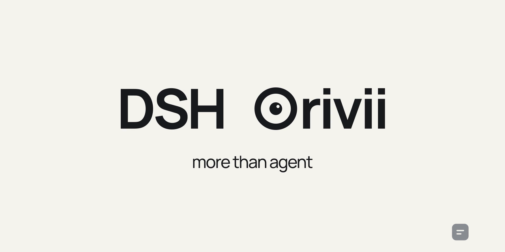
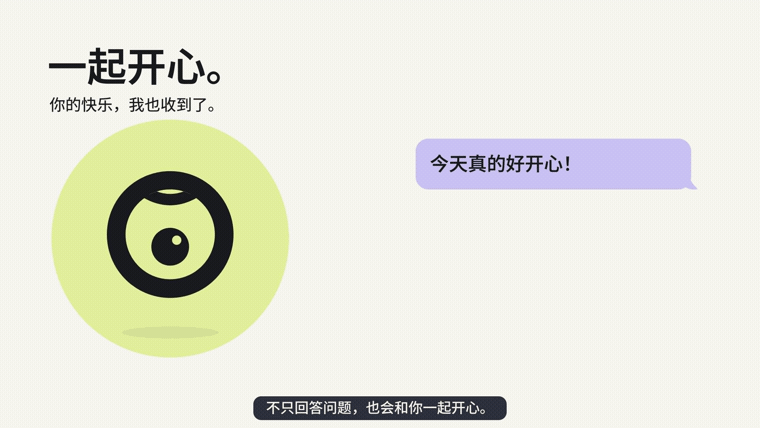
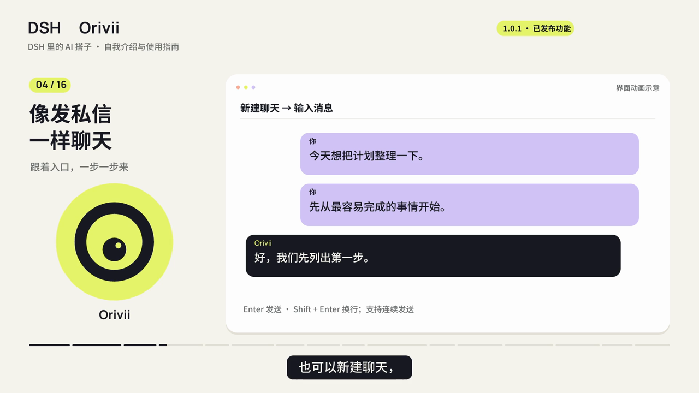
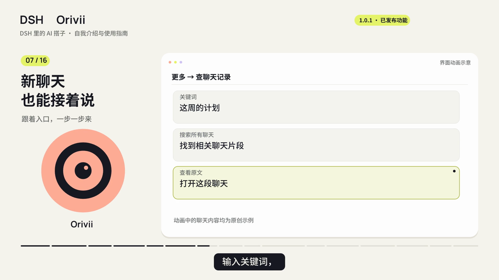
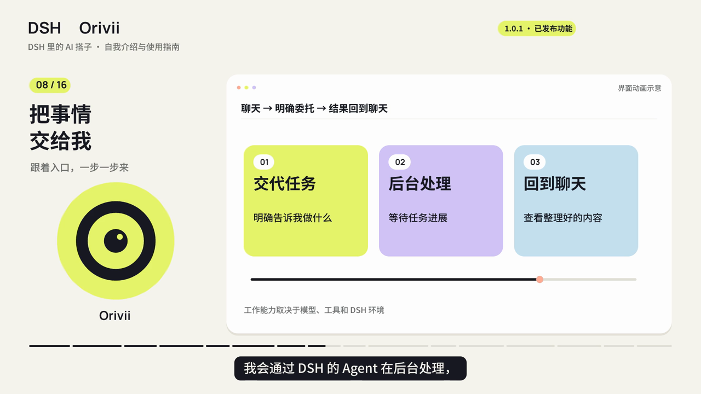
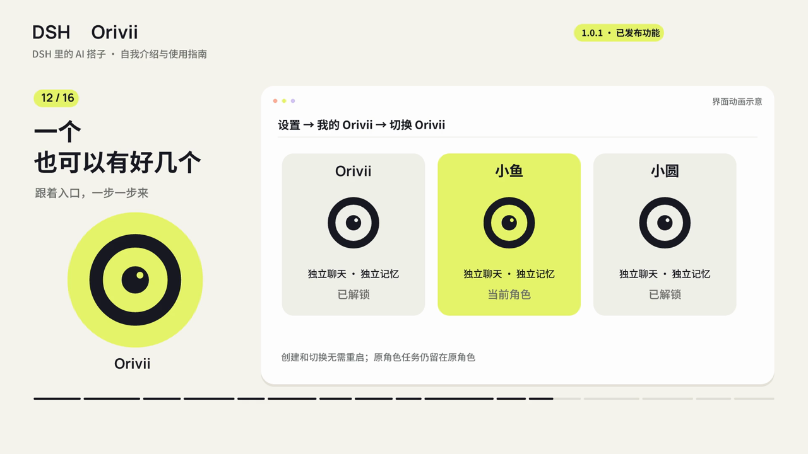
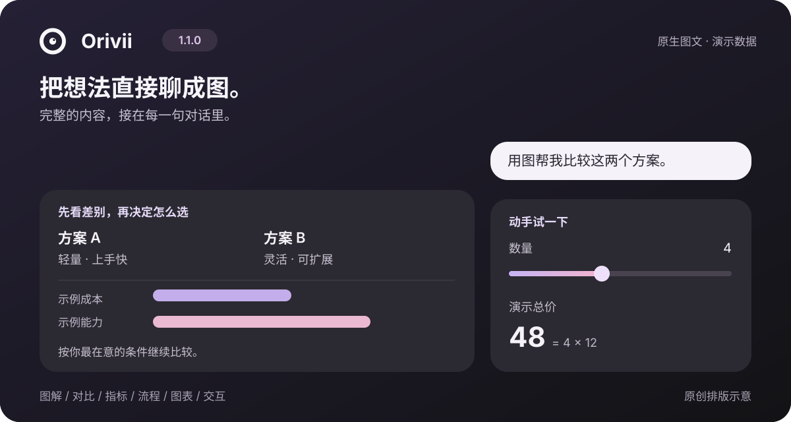

<p align="center">
  
</p>

<p align="center"><strong>Give your DSH an AI companion with a face.</strong><br><strong>Keep the conversation going. Let the work run in the background.</strong><br>Expressive eyes, shared chat history, reminders in your own words, and access to DSH tools.</p>

<p align="center"><a href="README.md">中文</a> · <a href="docs/README.md">User guide (Chinese)</a> · <a href="https://www.npmjs.com/package/dsh-orivii">npm</a> · <a href="https://github.com/ZekaiShi/Orivii/releases">Releases</a> · <a href="UPDATES.md">What's next</a></p>

## 1.2.0 · A quick reply, then the facts

Ask Orivii to look up the latest Node.js LTS version. When the public topic is clear, it acknowledges your request, checks sources through DSH in the background, and sends a separate answer. You can keep chatting while it looks.

- Readable pages and search snippets are treated as different kinds of evidence. Orivii says what remains unconfirmed when sources are missing. This flow requires a working DSH web service.
- Web conversations use the browser's time zone. Messages retain their send times, and expressions play in order across the initial reply and the follow-up.
- With the relevant settings enabled, Orivii can revisit unresolved public questions during idle time and return to the original chat if it finds a useful new lead.

[1.2.0 notes and upgrade guide](https://github.com/ZekaiShi/Orivii/blob/main/docs/updates/1.2.0.md) · [Update index](https://github.com/ZekaiShi/Orivii/blob/main/docs/updates/README.md)

## Get started

Get the matching [1.2.0 package](https://github.com/ZekaiShi/Orivii/releases/tag/v1.2.0) from GitHub Releases.

With a working DSH installation and a configured model, install the prebuilt plugin:

```sh
dsh plugin --profile web add https://github.com/ZekaiShi/Orivii/releases/download/v1.2.0/dsh-orivii-1.2.0.tgz
```

On Windows PowerShell, use `dsh.cmd` in place of `dsh`. Desktop users can add the same [package URL](https://github.com/ZekaiShi/Orivii/releases/download/v1.2.0/dsh-orivii-1.2.0.tgz) through the app's plugin manager. Follow the host's reload instructions, open **Orivii** in the sidebar, choose a workspace, and set a name and password.

Requires Node.js **≥24.2.0** and a compatible **DSH 0.2.1** host. The npm package is **`dsh-orivii`**; the npm package named `dsh-companion` is a different project. [Full installation guide](docs/getting-started.md)

## Meet Orivii

[](https://github.com/ZekaiShi/Orivii/blob/main/media/orivii-film.mp4)

[Watch the full 60-second film](https://github.com/ZekaiShi/Orivii/blob/main/media/orivii-film.mp4). The animated preview and tutorial frames below use original demonstration scenes.

| A place to talk | Pick up a conversation |
| --- | --- |
|  |  |
| **Background work** | **Multiple companions** |
|  |  |

- **A place to talk.** Independent chats, rich text bubbles, consecutive messages, and expressive eye animations.
- **A conversation that carries on.** Recent dialogue and searchable history are shared across chats within one identity. Recall can be incomplete; important details should be checked against the original conversation.
- **Help with real tasks.** Search through DSH's web service, arrange reminders in natural language, and delegate explicit work to DSH agents. Available tools and host permissions determine what can actually run.
- **More than one Orivii.** Version 1.0.1 adds independent identities with separate chats, memories, and preferences. Switch without restarting DSH.
- **Less repeated unlocking.** Choose the current DSH run, 8 hours, or 24 hours. Refreshing or switching does not extend the deadline. A manual lock or host restart requires unlocking again.

Reminders require the DSH host to remain running and the relevant identity to remain unlocked. They arrive in the chat, not as an alarm that works after shutdown.

## Upgrading an existing installation

Images, files, independent identities, unlock intervals, reminders, and background work remain available. Back up your workspaces before upgrading, then reopen the existing directories.

[Images, Bilibili, and appearance guide (Chinese)](docs/interaction-preview.md)

Charts, comparisons, explanations, and interactive examples can appear directly in chat. [Visual replies guide](docs/visuals.md)



## Make it yours

In **More → Settings → My Orivii** (`更多 → 设置 → 我的 Orivii`), create another identity or switch to an existing one. Renaming an identity preserves its data; creating a new one starts with independent records. [Identity and unlock guide](docs/identities.md)

Try asking:

> Call me Lin. Keep everyday replies short and warm, but be direct when we discuss code.
>
> Remind me to take a break in ten minutes.
>
> Look up the latest Node.js LTS version.

## Documentation

The detailed guides currently use Chinese and match the UI labels:

| Guide | Topics |
| --- | --- |
| [Getting started](docs/getting-started.md) | Windows, Linux, Desktop, Market, first conversation |
| [Everyday use](docs/usage.md) | Style, history, web search, reminders, background work |
| [Identities and unlocking](docs/identities.md) | Independent roles, switching, verification intervals |
| [Visual replies](docs/visuals.md) | Native layouts, charts, sliders, complete HTML/SVG previews |
| [Bilibili](docs/bilibili.md) | Plugin setup, login, screenshots, subtitles, reuse |
| [Reminders and background work](docs/reminders-and-work.md) | Schedule changes, quiet hours, delegation, result checks |
| [Data and migration](docs/data-and-privacy.md) | Storage, backups, upgrades, restoring on another computer |
| [Troubleshooting](docs/troubleshooting.md) | Installation errors, missing replies, reminders, UI |
| [Update index](docs/updates/README.md) | Current release, older versions, upgrade notes |

## Data, availability, and contribution

Chat and memory files stay in your chosen workspace, with optional password encryption. **Local storage does not mean offline processing**: your configured model receives the context needed to answer; web services receive necessary queries. Keep your password safe—lost encryption passwords cannot be recovered.

Co-watching, co-reading, and public-topic exploration are optional previews, off by default and dependent on host services. Voice calls, Office/PDF parsing, and new messaging channels remain planned work. See the [roadmap](UPDATES.md) and [release notes](CHANGELOG.md).

Issues and focused PRs are welcome. Use fictional data for reproductions and never attach credentials or real memory archives. [Contributing](CONTRIBUTING.md) · [Security](SECURITY.md) · [Media credits](media/README.md)

[MIT licensed](LICENSE). An independent community project, not affiliated with DeepSeek, OpenAI, or Apple.
