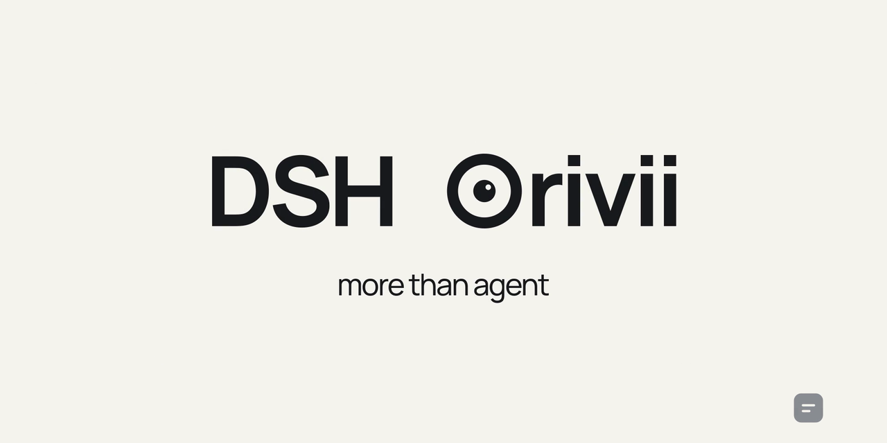
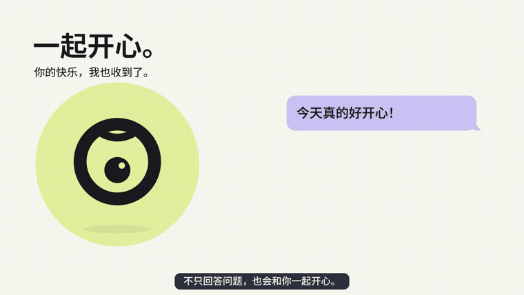
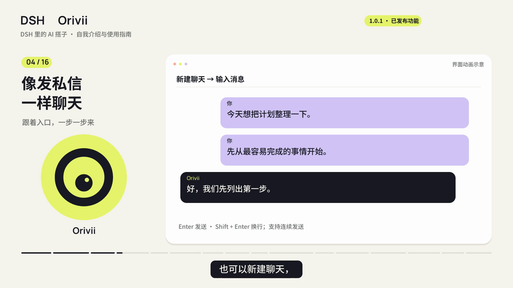
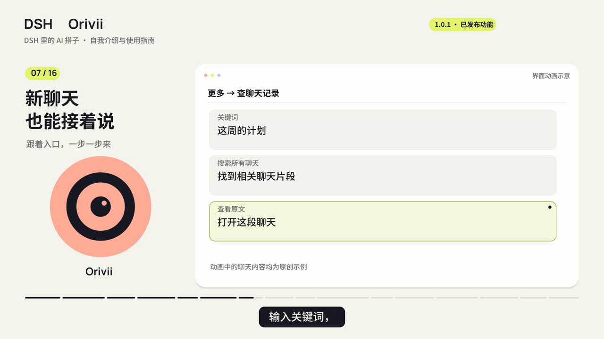
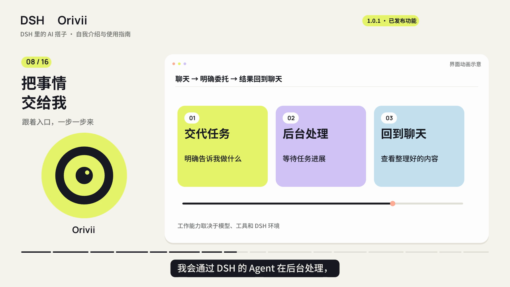
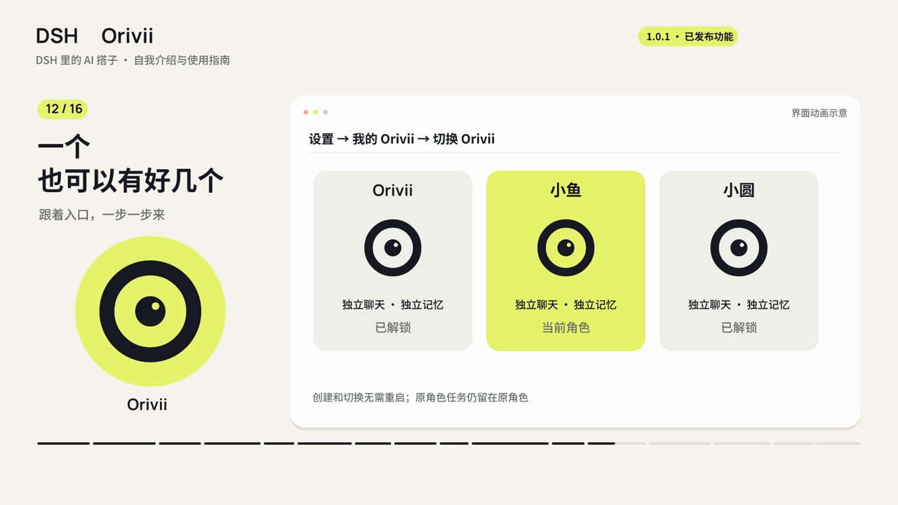
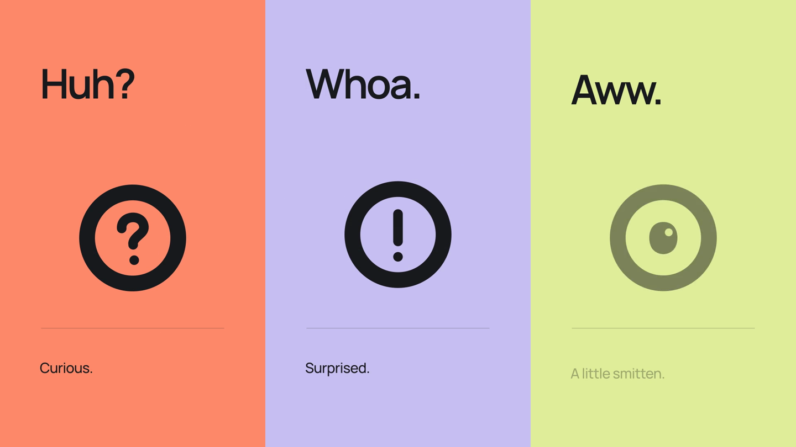
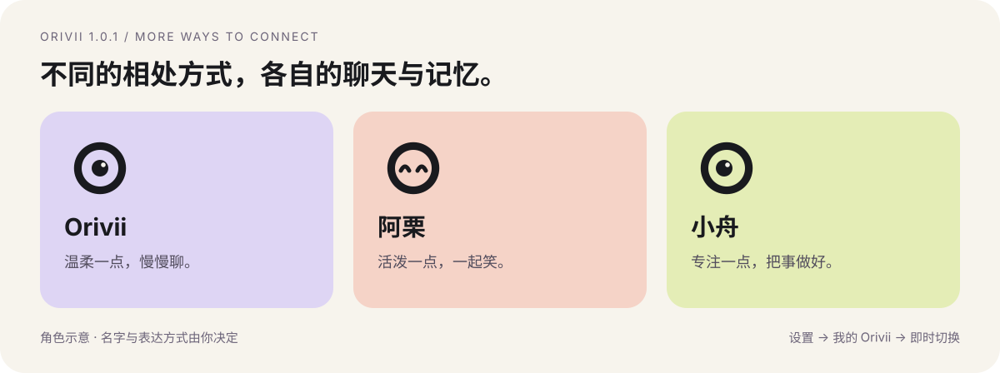

<p align="center">
  
</p>

<p align="center">
  <a href="https://www.npmjs.com/package/dsh-orivii"></a>
  <a href="https://github.com/awesome-dsh-plugin/awesome-dsh-plugin/blob/main/data/plugins/ZekaiShi__Orivii.yml"></a>
  <a href="https://github.com/ZekaiShi/Orivii/actions/workflows/ci.yml"></a>
  <a href="https://github.com/ZekaiShi/Orivii/blob/main/LICENSE"></a>
</p>

<p align="center"><strong>让 DSH 住进一个有表情的 AI 搭子。</strong></p>
<p align="center"><strong>聊过的事接着聊，交代的活在后台跑。</strong><br>会对你眨眼，记下你的习惯；一句话约定提醒，需要办事时接上 DSH 的工具。<br>给它取个名字，从第一句话开始认识彼此。</p>

<p align="center">
  <a href="#快速开始">开始使用</a> ·
  <a href="https://github.com/ZekaiShi/Orivii/blob/main/docs/README.md">使用教程</a> ·
  <a href="https://github.com/ZekaiShi/Orivii/releases">版本下载</a> ·
  <a href="https://github.com/ZekaiShi/Orivii/blob/main/UPDATES.md">接下来做什么</a> ·
  <a href="https://github.com/ZekaiShi/Orivii/blob/main/README.en.md">English</a>
</p>

## 快速开始

**已在使用 DSH？** 安装插件、选一个资料目录，就可以开始。模型沿用你在 DSH 中配置的服务。

1. **安装。** Web 用户在运行 DSH 的电脑上执行：

   ```sh
   dsh plugin --profile web add dsh-orivii@1.0.1
   ```

   Desktop 用户在应用内插件管理中添加 **`dsh-orivii@1.0.1`**，按提示重新启动。
2. **打开。** 点击左侧 **Orivii**，选择工作空间，设置名字与解锁密码。
3. **认识一下。** 发一句「叫我小林就好，平时说话简短一点」，开始你们的第一段对话。

需要 Node.js **≥24.2.0**、兼容的 DSH **0.2.1** 系列和可用模型。**npm 包名是 `dsh-orivii`**；`dsh-companion` 是其他项目，别装错。

[Windows PowerShell / Linux 安装步骤、Market 与离线安装 →](https://github.com/ZekaiShi/Orivii/blob/main/docs/getting-started.md)

## 先感受一下

[](https://github.com/ZekaiShi/Orivii/blob/main/media/orivii-film.mp4)

<p align="center"><a href="https://github.com/ZekaiShi/Orivii/blob/main/media/orivii-film.mp4">▶ 观看 60 秒宣传片</a></p>

*动图摘自 60 秒宣传片；下方四张图截自 1.0.1 功能教学视频，均为原创演示场景。*

| 像私信一样聊天 | 新聊天，也能接着说 |
| --- | --- |
|  |  |
| **把事情交给后台** | **不止一个 Orivii** |
|  |  |

| 日常相处 | 把事情接着做 |
| --- | --- |
| **像私信一样聊天**：独立聊天列表、连续发送、富文本气泡。 | **需要时查资料**：使用 DSH 的联网能力，把查询结果带回对话。 |
| **眼睛会回应你**：眨眼、思考、开心、困倦与唤醒，支持减少动态效果。 | **用一句话约定提醒**：创建、查询、改期和取消，到时在聊天中提醒。 |
| **新聊天也能接话**：同一角色共享近期对话与可检索历史。 | **把工作交给后台**：通过 DSH 的 Agent 执行明确委托，完成后带回结果。 |
| **按你的习惯相处**：名字、称呼、表达方式与可纠正的偏好。 | **资料由你保管**：本地工作空间，可选密码加密，支持备份与迁移。 |



联网需要可用的 DSH 搜索服务；后台工作取决于宿主已配置的工具与权限。提醒需要 DSH 持续运行、对应角色保持解锁，不是关机也能响的系统闹钟。

## 1.0.1 · 多一种相处方式



打开 **更多 → 设置 → 我的 Orivii**，创建和切换另一个角色。不同角色各自保存聊天、记忆和偏好，**切换无需重启 DSH**。

解锁期限可选 **本次 DSH 运行 / 8 小时 / 24 小时**。期限内刷新页面、切换回已解锁角色，不必重复输密码。手动锁定、DSH 退出或电脑重启后需要重新解锁。

[跟着做：创建第二个 Orivii、设置解锁期限 →](https://github.com/ZekaiShi/Orivii/blob/main/docs/identities.md)

## 不知道先聊什么？

下面是可复制的体验提示词，不是预先写好的模型回答。

| 想体验 | 发给 Orivii |
| --- | --- |
| 称呼 | 「叫我小林。平时简短温柔一些，讨论代码时直接一点。」 |
| 接着聊 | 先说「周末的阅读计划先定科幻小说」，新建聊天后问「接着刚才的阅读计划聊吧」。 |
| 查资料 | 「查一下这个项目最近一次官方更新，给我日期和原文链接；找不到就直说。」再附上项目链接。 |
| 提醒 | 「10 分钟后提醒我起来活动一下。」再问「我现在有哪些提醒？」 |
| 改期 | 「刚才活动的提醒改到 20 分钟后。」或「取消刚才那条活动提醒」。 |
| 办事 | 「在工作空间创建一个 hello.html，内容是欢迎使用 Orivii。完成后告诉我文件位置。」 |

记忆是可追溯的对话记录与整理结果，不代表每次请求都会带上全部历史。回答可能有遗漏，重要结论请核对出处。[日常使用与能力条件 →](https://github.com/ZekaiShi/Orivii/blob/main/docs/usage.md)

## 教程与帮助

| 你现在想做什么 | 从这里开始 |
| --- | --- |
| 第一次安装，发出第一条消息 | [快速入门](https://github.com/ZekaiShi/Orivii/blob/main/docs/getting-started.md) |
| 调整称呼、聊天方式，使用搜索与提醒 | [日常使用](https://github.com/ZekaiShi/Orivii/blob/main/docs/usage.md) |
| 创建多个角色，减少重复解锁 | [多个 Orivii 与解锁](https://github.com/ZekaiShi/Orivii/blob/main/docs/identities.md) |
| 升级、换电脑、保护聊天资料 | [数据与迁移](https://github.com/ZekaiShi/Orivii/blob/main/docs/data-and-privacy.md) |
| 安装失败、没有回复、提醒没来 | [常见问题与排错](https://github.com/ZekaiShi/Orivii/blob/main/docs/troubleshooting.md) |

## 一起把它完善

**现在可以使用：** 文字聊天、表情、跨聊天记忆、联网查询、自然语言提醒、后台委托、多角色与解锁期限。

**接下来完善：** 聊天与任务稳定性、文件交付、知识纠错与召回、Office 和科研工作流。可打断语音、同步陪看与更多官方消息渠道仍在计划中，**不属于 1.0.1 的可用功能**。

[查看完整更新计划](https://github.com/ZekaiShi/Orivii/blob/main/UPDATES.md) · [查看已发布更新](https://github.com/ZekaiShi/Orivii/blob/main/CHANGELOG.md)

欢迎告诉我们哪里不顺手，或提交一个小范围 PR。反馈时提供版本、环境和最短复现；请用虚构内容，不要上传密码、密钥或真实记忆库。

[报告问题](https://github.com/ZekaiShi/Orivii/issues/new?template=bug_report.yml) · [提出建议](https://github.com/ZekaiShi/Orivii/issues/new?template=feature_request.yml) · [参与贡献](https://github.com/ZekaiShi/Orivii/blob/main/CONTRIBUTING.md)

## 关于数据与许可

聊天与记忆保存在你选择的工作空间，可选择密码加密。**本地保存不等于离线处理**：回答所需的上下文仍会发送给你配置的模型，联网查询会发送必要查询词。密码遗失无法恢复加密资料。

[隐私与安全说明](https://github.com/ZekaiShi/Orivii/blob/main/SECURITY.md) · [宣传素材与许可](https://github.com/ZekaiShi/Orivii/blob/main/media/README.md) · [MIT License](https://github.com/ZekaiShi/Orivii/blob/main/LICENSE)

Orivii 是独立社区项目，不隶属于 DeepSeek、OpenAI 或 Apple。
