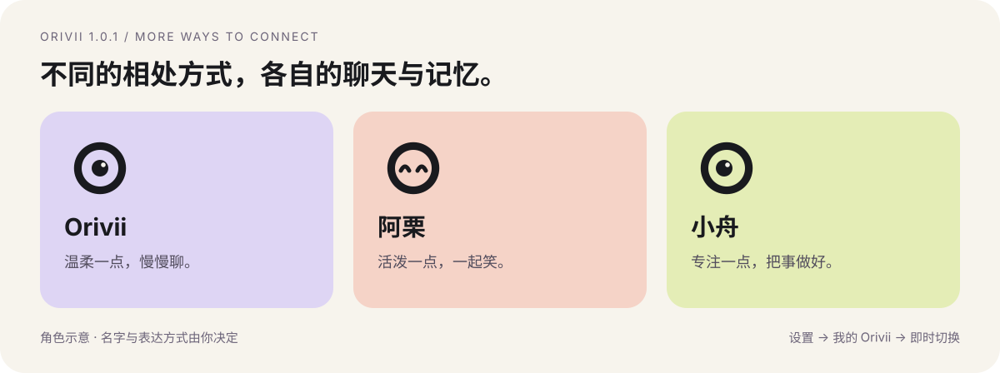

# 03 · 多个 Orivii 与解锁期限

[教程目录](README.md) · 上一篇：[日常使用](usage.md) · 下一篇：[数据与迁移](data-and-privacy.md)

一个角色可以有多个聊天。想要**独立的记忆和相处方式**时，再创建另一个 Orivii。

## 创建第二个角色

1. 打开 **更多 → 设置 → 我的 Orivii**。
2. 展开 **创建另一个 Orivii**，填写名字与 **最初的相处方式**。
3. 设置这个角色自己的解锁密码，或明确选择明文保存。
4. 点击 **创建并切换**。

例如，可以创建一个叫“阿栗”的角色，表达方式写成「活泼、爱开玩笑，涉及正事时讲清步骤」。它会从新的聊天与记忆开始，不会复制第一个角色的私人记录。

资料目录会自动创建在初始工作空间下的 `.orivii-profiles` 中。目录名不是角色名字；迁移时不要只复制你看到的名字或某一份文件。

## 随时切换，无需重启

在 **我的 Orivii → 切换 Orivii** 中选择角色，然后点击 **切换到这个 Orivii**。角色若尚未解锁，先输入它自己的密码。

- 已解锁且未到期限的角色可以直接切回。
- 如果输入框有草稿或消息尚未送达，先处理这些内容，再切换，避免消息发给错误的角色。
- 已派发的后台文字工作仍属于原角色。切换不会把任务结果或记忆转交给新角色。

**不要只改名字来模拟两个角色。** 改名字保留原来的资料；创建新角色才会得到独立的聊天与记忆。

## 解锁期限怎么选？

首次打开工作空间时可选择，也可在 **我的 Orivii → 当前 Orivii 的解锁期限** 中调整。

| 选项 | 何时需要再次输入密码 |
| --- | --- |
| 本次 DSH 运行 | 手动锁定、DSH 后端退出或电脑重启后 |
| 每 8 小时验证 | 本次验证起 8 小时到期，或提前锁定 / 退出后 |
| 每 24 小时验证 | 本次验证起 24 小时到期，或提前锁定 / 退出后 |

刷新页面、关闭后重新打开、切换回来，都不会重新计算期限。将策略改得更长，要在下次输入密码后才生效；不是修改选项就可以跳过正在到期的验证。

解锁状态只保存在当前 DSH 后端进程中，不会把你的密码写进浏览器。Web 与 Desktop 分别运行时，验证状态也分别管理。

## 关闭页面与锁定有什么区别？

**关闭页面**不会自动锁定记忆库，DSH 仍在运行时，已解锁角色的后台工作可以继续。

**更多 → 锁定**会锁住当前 DSH 后端中全部已解锁的 Orivii，停止相应工作并清除解锁状态。它不只锁当前角色；另一个独立运行的 Web / Desktop 后端需要分别锁定。

重启 DSH 或电脑后再次验证是正常行为。「本次 DSH 运行」也不是永久免密。

## 三个常见问题

**新角色能记得旧角色的聊天吗？** 不会自动共享。如果只是想换话题，请新建聊天，不必新建角色。

**能用同一个密码吗？** 每个加密角色单独验证。请自行妥善保管各角色密码；任何角色丢失密码都无法恢复其加密资料。

**找不到某个旧角色？** 先确认连的是原来的 DSH 后端、资料目录是否仍在。换机器后，选择原角色工作空间并解锁。不要在找不到旧数据时直接创建同名角色代替。[恢复步骤](data-and-privacy.md#恢复与换电脑)
